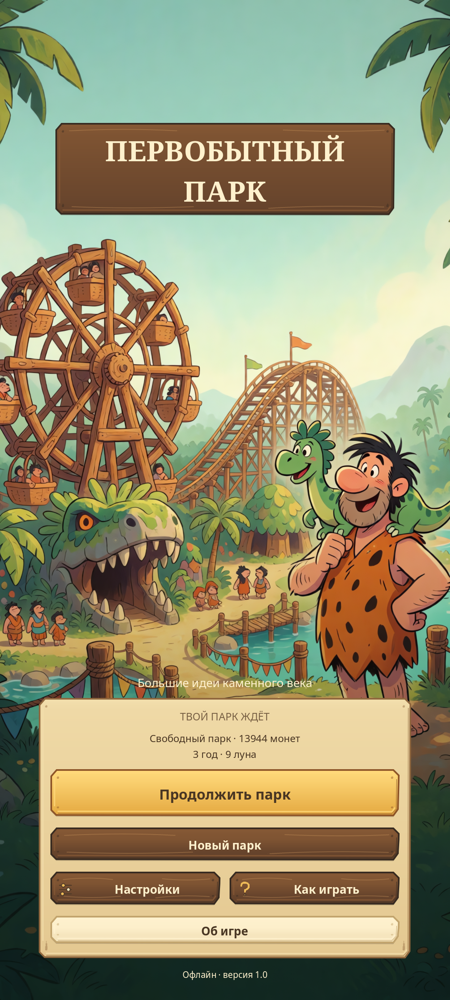
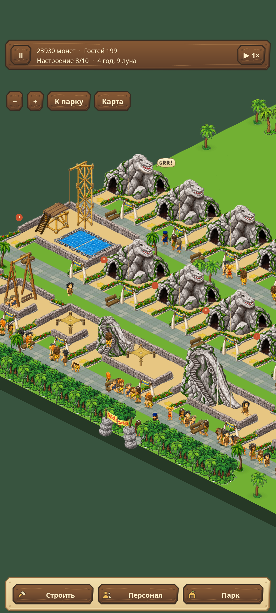
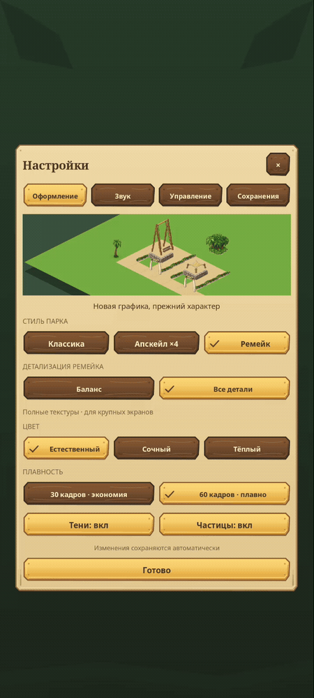

# Первобытный парк

**Большие идеи каменного века. Теперь — на Android.**

Парк аттракционов, где мотором служит динозавр, кассы строят из камня,
а хорошая дорожка порой важнее самых дорогих горок.

**24 аттракциона · 27 объектов · 6 сценариев · 3 стиля графики · полностью офлайн**

[Скачать APK 1.1.0](https://github.com/etosheartem/prehistorik-park/releases/latest) · [Что нового](docs/release-1.1.0.md) · [Сборка и проверки](docs/development.md)

**Обновление 1.1.0:** очереди на дорожках, точная посадка, рабочие места сотрудников, стрелки строительства, отдых на скамейках и прозрачные деревья. [Скриншоты и изменения](docs/release-1.1.0.md).

Порт «Первобытного парка» Gear Games с восстановленными правилами J2ME-оригинала
и интерфейсом для большого сенсорного экрана. Строй, соединяй входы дорожками,
нанимай сотрудников и следи за настроением гостей. Здесь важны расположение,
цены, обслуживание и работающая экономика.

## Парк, в который удобно возвращаться

- **Три понятных раздела:** строительство, персонал и твой парк. Каталог с поиском,
  настоящими превью и сохранением прокрутки. Размещение с поворотом входа и подтверждением.
- **Камера под пальцами:** движение одним пальцем, масштаб двумя, большая карта
  и быстрый возврат к постройкам. Снос требует подтверждения.
- **Несколько способов играть:** обучение, пять следующих сценариев, свободный парк,
  соревнование и две сложности. Можно остановить время или ускорить его до 4×.
- **Парк остаётся твоим:** автосохранение, личная копия, восстановление предыдущего парка
  и перенос JSON-файлом через системный диалог Android.
- **Без аккаунтов, рекламы и подключения:** в APK нет разрешения на интернет.
  Музыка и звуковые эффекты хранятся на устройстве.

## Ремейк, который можно настроить под себя

В **1.0.1** восстановлены задние цветники и ограждения 23 аттракционов,
надпись «GRR!», фрагменты камней и неверные кадры посетителей.
Проведена [сверка ресурсов и анимаций с оригиналом](docs/qa/remake-1.0.1.md).

Изменения сразу видны в маленьком **живом парке**. Предпросмотр не затрагивает
твою игру и не двигает её время.

| Настройка | Что меняется |
| --- | --- |
| Классика | Исходные пиксели и родная заставка |
| Апскейл ×4 | Те же рисунки, локально увеличенные Real-ESRGAN; стиль по умолчанию |
| Ремейк · Баланс | Новые рисунки, компактные текстуры и сглаживание 2× в Vulkan |
| Ремейк · Все детали | Полные текстуры и сглаживание 4× в Vulkan |
| Естественный / Сочный / Тёплый | Цвет парка в режиме ремейка |
| 30 / 60 кадров | Независимый предел частоты кадров |
| Тени и частицы | Отдельные переключатели эффектов |
| Управление | Скорость камеры, сетка строительства, уменьшение движения |
| Звук | Раздельная громкость музыки и эффектов, проверка звучания |

Профиль «Баланс» использовал **на 42% меньше памяти текстур**, чем «Все детали»,
в сравнительном рендере парка с 200 гостями на ПК. Это измерение GPU-текстур,
а не обещание расхода памяти или FPS на любом телефоне. [Условия проверки](docs/qa/README.md).

[Видео с эмулятора Android](docs/media/android-tour.mp4) ·
[Каталог](docs/media/catalog.png) · [Звук](docs/media/audio.png) · [Сохранения](docs/media/saves.png)

Все кадры интерфейса сняты с работающей APK в Android Emulator, 1080×2400.
Видео и GIF показывают реальную игру; иллюстрация заставки создана отдельно.

## Установить и попробовать

1. Скачать `prehistorik_park_1.0.1.apk` из [последнего релиза](https://github.com/etosheartem/prehistorik-park/releases/latest).
2. Установить на **Android 7.0+ с ARM64**. Сборка обновляет ранее установленные 0.3 и 1.0.0
   с тем же сертификатом без удаления сохранения.
3. Начать с обучения или выбрать «Настройки → Оформление → Ремейк».

Для быстрого знакомства есть [готовый парк](docs/demo-park.json): 45 построек,
200 посетителей. Сохрани файл на телефон и открой через
**Настройки → Сохранения → Импорт из файла**. Перед заменой игра сохраняет текущий парк
отдельно. Демопарк получен из успешного прохождения шестого сценария автоматическим
игроком; для дальнейшей игры он переведён в свободный режим.

## Проект

| Каталог | Содержание |
| --- | --- |
| `game/` | Проект Godot, игра, ресурсы и проверки |
| `original/` | Разбор JAR, исходные правила, экспорт данных и сверки |
| `art/` | Генераторы, локальный апскейл, исходники и происхождение арта |
| `tools/` | Проверки, сборка APK, запуск Android Emulator |
| `docs/` | Правила, инструкция разработчика, медиа и отчёт релиза |

Для запуска на ПК: `godot --path game`. Для проверки: `bash tools/check.sh`.
Подробные зависимости и Android-сборка — в [инструкции разработчика](docs/development.md).

Оригинальная игра и её ресурсы принадлежат Gear Games и соответствующим правообладателям.
Это частный неофициальный проект, не публикация от Gear Games. [Происхождение и лицензии](NOTICE.md).
