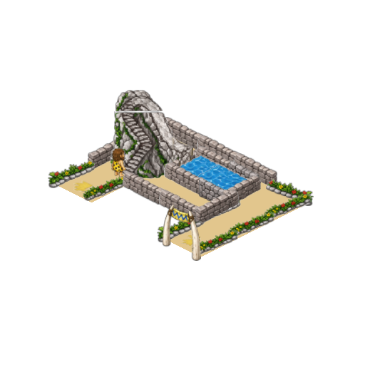
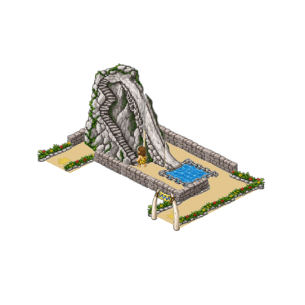
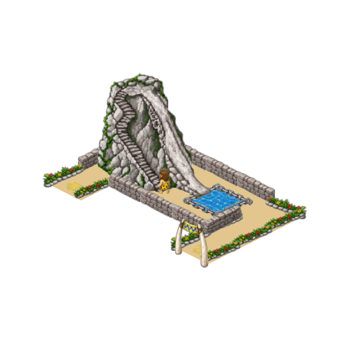
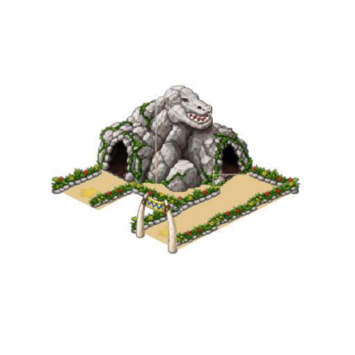

# Стыки и управление — 1.1.1

Проверка началась с сообщения о несклеенных горках. В ремейке подтверждены
щели между отдельными PNG водной/батутной горок, горы/горы с лужей и комнаты
страха. У рисованных деталей на внутренних срезах остались прозрачные поля
и светлая обводка. Присутствие всех деталей в 1.1.0 не исключало этот дефект.

Выборка десяти деталей сдвинута внутрь обводки; их внутренние края перекрываются
не более чем на один исходный пиксель. Исходные PNG, команды анимации, размеры
площадок и положение пассажиров не менялись. Исправление воспроизводится через
`art/repair_geometry.py`, применяется обоими профилями ремейка и каталогом.

| Сцена | 1.1.0 | 1.1.1 |
| --- | --- | --- |
| Маленькая горка |  |  |
| Большая горка |  |  |
| Комната страха |  |  |

`joints_check.gd` проверяет реальные пиксели шести швов: два профиля ремейка,
масштабы 0.75/1/2.75/5/7, целая и дробная позиция камеры. Контроль с отрисовкой
1.1.0 воспроизводит щель на маленькой и большой горке. После исправления не
менее 95% измерений каждого шва имеют альфу ≥0.9. GPU: 249 проверок, headless:
121 проверка контракта. [Числа](1.1.1/joints_gpu.json).

Рельсы трёх американских горок отдельно проверены на связность: 12 уникальных
вариантов геометрии в 210 фазах, исходная графика и ремейк. В каждом случае —
одна связная область, новых разрывов не найдено. [Отчёт](1.1.1/coaster_tracks.json).
Это проверка геометрии рельсов, а не оценка красоты всех деревянных опор.

Полный рендер: 7821 кадр, 1191 сохранённое сравнение, обе ориентации входов,
все фазы, заполненные аттракционы. Пересобраны 153 карточки каталога;
изменились только пять карточек ремейка.

Дополнительно исправлены:

- Камера при стрелках: положение панели читается после завершения переноса
  текста, с учётом верхних кнопок, подсказки и обучения. Близкий шаг не двигает
  уже правильно расположенную камеру; устаревшие запросы отменяются.
- Подсказка о неподключённых входе/выходе до покупки. Дорожки можно достроить
  позже, поэтому предупреждение не блокирует строительство.
- Закреплённые вкладки персонала и прокрутка с начала при переключении.
- Прокрутка нанятой команды пальцем: PanelContainer карточки перехватывал
  касание. Теперь жест передаётся ScrollContainer. Регрессия проверяет
  настоящую последовательность touch/drag и отсутствие увольнения при свайпе.

Полный `tools/build_apk.sh` завершён; результаты находятся в [1.1.1](1.1.1/).
Проверка APK на Android описана в [android.json](1.1.1/android.json).
Проверки выполнены на ПК и эмуляторе API35; физический телефон не использовался.
В GitHub-релиз прикладывается только APK, описание содержит только исправления.
