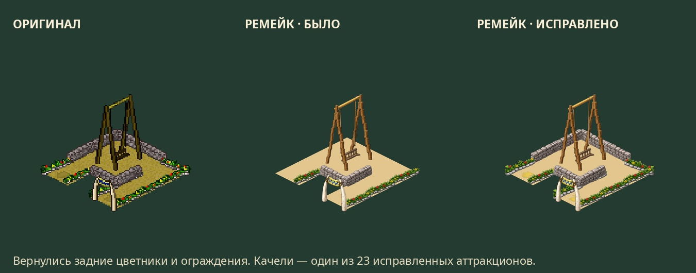

# Первобытный парк 1.0.1

**13 октября 2026 · Android 7.0+ · ARM64 · офлайн**

Вернули детали, которые терялись при отрисовке ремейка.

- Задние цветники, стены и пороги теперь рисуются у всех 23 обычных аттракционов.
  Исправление видно в парке, каталоге и живом предпросмотре настроек.
- Передние ограждения сохраняются в полупрозрачном режиме размещения.
- У комнаты страха снова есть надпись «GRR!».
- В разлёте камней восстановлены нижние фрагменты и исходные точки размещения.
- Исправлены четыре сидячие позы посетительниц и шесть кадров голов,
  которые меняли ракурс при неизменном оригинале.
- Исправления включены в сборщики ресурсов; добавлены проверки их сохранности.

Сверены 499 пар ресурсов и исходных кадров. Проверены все 1209 фаз аттракционов
и 135 фаз объектов; выполнена 7821 отрисовка оригинала и двух профилей ремейка.
APK установлена поверх 1.0.0 в Android Emulator, парк и настройки сохранены.

В приватном релизе есть APK, контрольные суммы и архив сравнений. Распакуй
`remake-audit-1.0.1.zip` и открой `index.html`: там отдельные текстуры,
каталог, анимации и оба направления входа.

[Подробности проверки](qa/remake-1.0.1.md) · [Скачать APK](https://github.com/etosheartem/prehistorik-park/releases/tag/v1.0.1)
