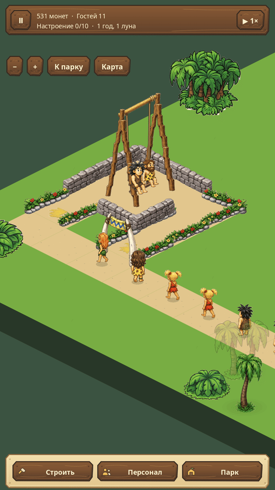
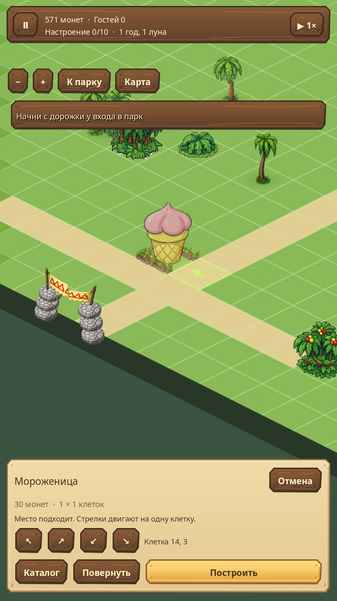
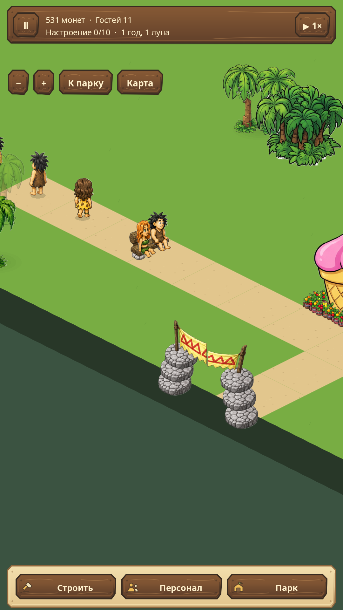

# Первобытный парк 1.1.0

**14 октября 2026 · Android 7.0+ · ARM64 · офлайн**

Обновление по замечаниям после первых трёх аттракционов: посетителям теперь есть
где ждать и отдыхать, у сотрудников появились постоянные рабочие места,
а стройку можно точно подвинуть стрелками.

- **Живая очередь.** Гости идут к хвосту и продвигаются к входу после посадки.
  У соседних аттракционов отдельные места на дорожке.
- **Посадка без полётов.** Исправлена исходная точка пассажиров качелей,
  двухъярусной карусели и других аттракционов с неподвижной базовой клеткой.
- **Понятные лавки.** В карточке видны сотрудник и причина остановки.
  Нужного работника можно нанять сразу сюда. Если прилавок смотрит не на дорожку,
  кнопка «Повернуть вход» меняет сторону без сноса и потери сотрудника.
- **Постоянная команда.** Второй сотрудник не заменяет первого. Есть отдельные
  вкладки найма и команды, поиск работника в парке, переназначение и увольнение
  конкретного человека. Повар работает в кафе; продавец — в закусочной,
  мороженице и лавке шариков.
- **Точная стройка.** Четыре стрелки двигают выбранное место на одну клетку.
  Входы и нужные дорожки подсвечены; деньги списываются после подтверждения.
- **Скамейки с гостями.** Доступны в разделе «Дорожки», имеют два места.
  Уставшие посетители заранее занимают свободное место и садятся отдыхать.
  Исправлен порядок отрисовки спинки и сидящих людей.
- **Деревья не мешают обзору.** Кроны перед гостями, постройками и местом
  строительства становятся прозрачными. Настройка находится в «Управлении».

Сохранения совместимы с 1.0.1. Обновляй APK поверх установленной игры.
Проверены все 12 сочетаний сценария и сложности, полный набор тестов,
7821 отрисовка с заполненными аттракционами и установка на Android Emulator
с сохранением существующего парка на 200 гостей.

[Скачать APK](https://github.com/etosheartem/prehistorik-park/releases/tag/v1.1.0)
· [Как проверяли](qa/gameplay-1.1.0.md)
